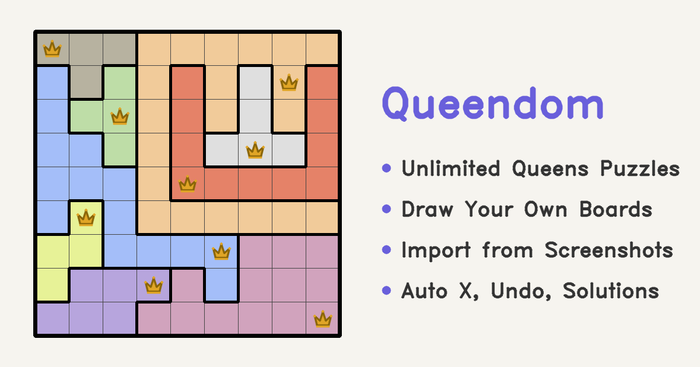

<div align="center">
<h1>Queendom</h1>
</img>
<br>
<br>


</div>

**Queendom** is a puzzle game inspired by LinkedIn's
[Queens](https://linkedin.com/games/queens) that you can play as often as you
like, with your own puzzles.

Built on [queens-clone](https://github.com/sihlecodes/queens-clone) by
Siphesihle Mhlongo.

**Play it at https://anindya-saha.github.io/queendom/**

## How to play

Place exactly one queen in each **row**, **column**, and **color region**. Two
queens can't touch each other, not even diagonally. Tap a cell once for an X
(a cell that can't hold a queen) and twice for a queen.

## Features

- **Unlimited play:** replay any puzzle as often as you like. Solved puzzles
  show a ✓ and your best time.
- **Board editor:** paint the color regions of a puzzle yourself. Load a
  picture of the board behind the grid (with adjustable opacity, zoom and
  position) and trace over it. The editor checks that every color forms one
  connected region before saving.
- **Screenshot import:** load a screenshot or photo of a Queens board and the
  regions are detected with OpenCV, then opened in the editor for you to check.
- **Auto X's:** placing a queen marks every cell it blocks, and removing it
  clears them again. Manual X's are never touched. Can be turned off.
- **Undo:** step back through moves with the Undo button or Ctrl/⌘+Z. A whole
  drag stroke is one step.
- **Solutions:** solved puzzles remember their solution so you can view it
  again, without affecting your best time.
- **Puzzle library:** rename, reorder (drag) and delete puzzles.
- **Responsive layout:** single column on phones; board and instructions side
  by side on wide screens.

Your puzzles, names, order, and solutions are stored in your browser's local
storage. They stay on your device and are not uploaded anywhere.

## Running locally

Requires [Node.js](https://nodejs.org) 20.19 or newer.

```shell
git clone https://github.com/anindya-saha/queendom.git
cd queendom
npm install
npm start
```

Then open http://localhost:3050 in your browser.

Other commands:

```shell
npm test            # run the test suite (Vitest)
npm run build       # production build into dist/
npm run preview     # serve the production build
npm run og-image    # regenerate the link-preview image
```

The app is plain HTML, CSS, and JavaScript (ES modules), served and bundled
with [Vite](https://vite.dev). Pushing to `main` runs the tests, builds, and
deploys to GitHub Pages via `.github/workflows/static.yml`.

## Credits

Based on [queens-clone](https://github.com/sihlecodes/queens-clone) by
Siphesihle Mhlongo, which provided the original game, controls, and screenshot
loading. Released under the [MIT License](LICENSE).
